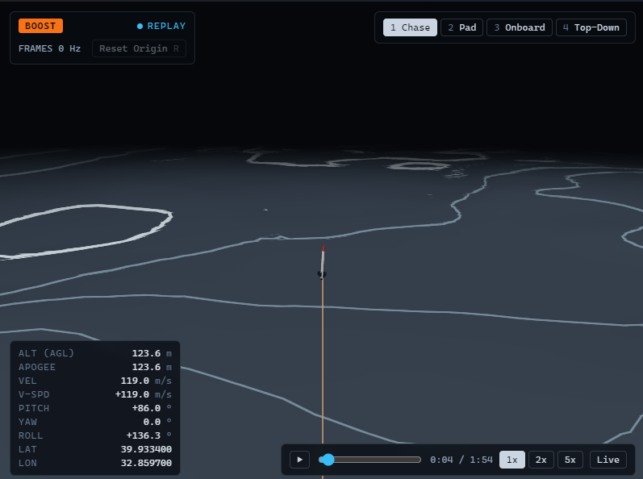

# apogee-view

Desktop ground-station viewer for model rocket telemetry. Listens for packets on UDP, shows the rocket's attitude and flight path in 3D over real terrain, and logs every flight to disk so it can be replayed later.

Built with Tauri 2 (Rust), Svelte 5 and Three.js.



## Features

- UDP listener on `127.0.0.1:5005`, accepts JSON or a packed binary format
- 3D view with flight trail, drop-line to ground and several camera modes
- Terrain from Terrarium DEM tiles with topo contour lines, cached on disk for offline use
- Every flight is recorded as JSONL and can be replayed with a timeline

## Running

Requirements: Node 20+, Rust stable, and the [Tauri prerequisites](https://v2.tauri.app/start/prerequisites/) for your OS.

```sh
npm install
npm run tauri dev
```

No rocket? There's a simulated flight in `examples/`:

```sh
python3 examples/mock_flight.py              # JSON packets, 50 Hz
python3 examples/mock_flight.py --mode binary --rate 20
```

## Packet format

JSON:

```json
{
  "ts": 12345,
  "quat": [1, 0, 0, 0],
  "gps": { "lat": 39.9334, "lon": 32.8597, "alt": 850.0 },
  "baro_alt": 851.2,
  "state": "boost"
}
```

- `quat` is `[w, x, y, z]` in the NED frame. You can send `euler: [roll, pitch, yaw]` in degrees (ZYX order) instead.
- `baro_alt` is optional. When present it's used instead of GPS altitude.

Binary (42 bytes, little-endian, packed): header `0xAA 0x55`, `ts: u32`, `quat: 4×f32`, `lat: f64`, `lon: f64`, `alt: f32`.

## Flight logs

Logs are written to the app data directory under `flights/`, one `.jsonl` file per session.

## Status

Early prototype. Tested with the simulated flight so far, not yet with real hardware.
